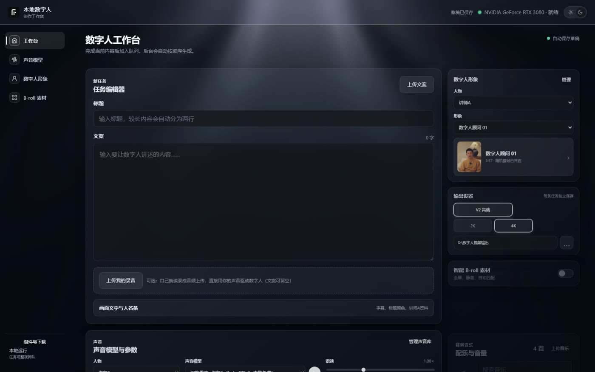
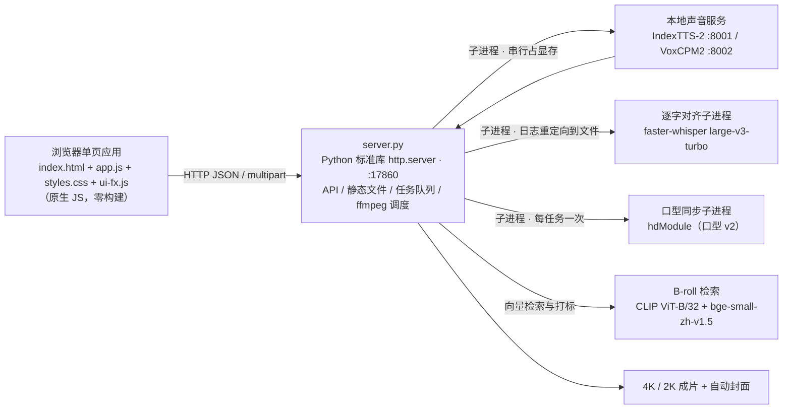

# 本地数字人工作台 · LocalDigitalHuman

**一台 Windows + NVIDIA 显卡的机器上，从一段文案到 4K 数字人成片的完整本地流水线。**

纯本地运行的数字人短视频生成工作台：输入文案 → 克隆声音合成语音 → 口型同步驱动数字人形象 → 叠加字幕 / 标题 / 人名条 / 智能 B-roll / 背景音乐 → 导出 4K / 2K 成片并自动选帧生成封面。语音、口型、逐字对齐、素材检索全部跑在本地，不依赖云端服务，也支持任务队列整夜排队生成。后端是单文件 Python 标准库 HTTP 服务，前端是无构建的原生 JS 单页应用，代码与工程约束都是围绕「给别人的电脑装一个能直接跑的桌面工具」设计的。

- 🔒 **纯本地运行** —— 声音、口型、对齐、检索模型全部本地推理（ElevenLabs 仅作云端备选，可用可不用）
- 🐍 **后端只用 Python 标准库** —— `http.server` 单文件承载 API / 静态文件 / 任务队列 / 进程调度
- 🧩 **前端零构建** —— 原生 JS + 手写 CSS，无 npm、无打包器、无 CDN 依赖，双击即用
- 🖥️ **Windows 10/11 + NVIDIA GPU** —— 开发机 RTX 3080 10GB，显存阈值可配
- 🎬 **4K / 2K 导出** —— 成片 + 自动封面，支持竖版与横版（16:9 / 4:3）两套字幕适配

---

## 演示与截图

**在线访问**（中国大陆直连，无需代理）：<http://82.156.149.226:8080/>
**源码仓库**：<https://github.com/wangfeilaing/LocalDigitalHuman>


仓库自带一个**纯静态在线演示站**（`showcase/`）：脱敏假数据、可点真实界面，不需要显卡也不需要装任何依赖就能看完整交互。

```bash
python -m http.server 8080 --directory showcase
# 然后打开 http://127.0.0.1:8080/
```

- `showcase/index.html`：项目落地页（Hero 成片循环、界面截图、能力说明）
- `showcase/demo/`：**真实前端接假数据** —— `app.js` / `styles.css` / `ui-fx.js` 是从项目根目录复制并打补丁的副本，由 `demo-api.js` 拦截 `fetch` 并用 fixture 应答，所以四个面板、人物切换、队列与进度条都能真点
- `showcase/build/build_showcase.py`：一键重建演示站（分 `media` / `data` / `frontend` / `shots` 四个阶段：素材转码、fixture 脱敏生成 `demo-data.js`、前端同步打补丁、Edge 无头截图）
- 部署到公网（面向面试场景的平台对比与步骤）见 [`showcase/DEPLOY.md`](showcase/DEPLOY.md)



---

## 核心能力

1. **双本地声音引擎（IndexTTS-2 / VoxCPM2）** —— 声音档案带 `engine` 字段路由到两个独立服务（IndexTTS-2 在 `voiceV2Module` 的 venv、`:8001`；VoxCPM2 在项目内 `voxcpm_service.py`、`:8002`），对外接口契约完全一致（`GET /health`、`POST /generate`），同一时刻只运行一个，切换引擎自动停旧启新。参数按引擎真实透传：IndexTTS-2 的情感强度 0–1 / 情感描述，VoxCPM2 的贴合度 `cfgValue` 1–5 与推理步数 4–30；语速统一 0.5–2.0（VoxCPM 侧用 ffmpeg `atempo` 后处理）。另支持「自己录音」模式：真人录音直接跳过 TTS 驱动数字人。

2. **字幕逐字对齐（不做估算）** —— 不再按「字数 + 标点权重」猜时间轴，改为逐字强制对齐：faster-whisper `large-v3-turbo` 出词级时间戳，再与文案净字符流做 `difflib` 锚定——equal 块直接取识别时间，**replace 块（同音错字）取识别侧该词的时间区间，delete 块（漏字）在锚点间插值**，识别错字不污染对齐，匹配率 < 50% 主动报错让上层回退；CUDA float16 推理，显存不足自动回退 CPU int8。实测 **407 秒音频全程 29 秒**（含模型加载）。回退引擎为 FunASR 时间戳预测（CPU），长音频走「能量静默点切 ≤12 秒块 + 两遍分块」对齐。

3. **口型同步（hdModule 子进程）** —— 每个任务以子进程方式调用口型 v2 模块（`model_worker.py`），输入视频先压到长边 1920 再喂模型，导出时 lanczos 放大到 2K / 4K；profile 字符串包含分辨率参数，改值会自动重建 `data/model-inputs` 缓存；任务结束统一清理残留子进程，避免常驻占显存。

4. **智能 B-roll** —— 用 `bge-small-zh-v1.5` 对素材与文案做向量化，`plan_broll_segments` 按**逐字对齐后的真实时间窗**生成检索 query 并排序召回；镜头内的素材由 `clip-vit-base-patch32` 打标，片段时长约束在 4–7 秒；素材按人物分组，优先匹配所选形象所属人物的素材，无候选再回落到全库。

5. **任务队列（整夜排队）** —— `data/task-queue.json` 持久化队列，声音分段合成支持断点续跑（`temp/voice-checkpoints`），单条任务可「停止 / 删除」；取消通过全局 `MAIN_CANCEL` Event + `TaskCancelled` 异常 + `raise_if_main_cancelled()` 检查点穿透到子进程树；前端对每条任务区分显示「耗时 / 已进行 / 已等待」。

6. **交付工程化（安装包与组件向导）** —— `installer/` 用 Inno Setup 打免管理员安装包（装到 `%LOCALAPPDATA%\Programs\LocalDigitalHuman`），staging 约 2.1GB：代码 + 口型模块 + ffmpeg + 嵌入式 Python，模型权重一律不随包。首次启动走「组件与下载」向导按需拉取（faster-whisper CT2 模型、bge、clip、torch wheel），走 ModelScope 文件直链 + Range 断点续传，也支持「组件离线包」全离线安装；路径按「环境变量 > `local-config.json` > 安装目录默认候选」三级解析。

---

## 架构



### 为什么不用框架

不是偏好问题，是被运行环境倒逼的：

- 安装包里给目标机的**嵌入式 Python 只有标准库**，其 `._pth` 不会把脚本目录加进 `sys.path`，所以 `server.py` 必须保持只依赖标准库（唯一的例外是打进包的封面组件，由构建脚本显式打开 `Lib\site-packages`）；
- **目标机没有 npm、没有前端构建工具链**，也没法要求装；
- 因此：后端不用 Flask/FastAPI，前端不用框架与打包器——路由、静态文件、multipart 上传、队列、进度上报都自己写，代价可控；收益是安装包不必携带任何 Web 运行时，双击 `启动本地数字人.vbs` 就能跑。

---

## 运行环境与依赖

| 项目 | 要求 |
|---|---|
| 操作系统 | Windows 10 / 11（安装包免管理员） |
| GPU | NVIDIA，开发机 RTX 3080 10GB；显存阈值默认 **6500MB**（`gpuMinFreeMB`，可改配置并热生效） |
| Python | 3.10（hdModule 的 pyd 是 **cp310** 编译，必须 3.10） |
| ffmpeg | 随安装包内置（`runtime/ffmpeg/`），用于转码、混音、ASS 烧录、导出 |
| 可选包 | `jieba`（字幕断句）、`psutil`（进程清理） |

**模型与组件不入库**：`.gitignore` 已排除 `modules/`、`runtime/`、`data/models/`、`data/modelscope-cache/` 等大体积二进制目录（`temp/`、`logs/`、`backups/`、本地配置与队列状态同样不入库）。首次使用通过界面里的「组件与下载」向导按需拉取组件；显存阈值等配置可在向导里热写 `local-config.json`，免重启生效。

---

## 快速开始

1. 双击 **`启动本地数字人.vbs`**：脚本先探测 `/api/ping`，未运行则用安装目录内的 `runtime\python\pythonw.exe`（回退 `modules\voiceV2Module\venv\pythonw.exe`）拉起 `server.py`，再用 Edge 的 app 模式打开界面。
2. 浏览器访问 **`http://127.0.0.1:17860`**（服务端口可用 `LOCAL_DH_PORT` 覆盖）。
3. 调试入口：

```bash
curl http://127.0.0.1:17860/api/ping          # 服务健康
curl http://127.0.0.1:17860/api/queue         # 队列快照（含 main job 的 stage/progress 叠加）
curl "http://127.0.0.1:17860/api/job?kind=main"   # 任务进度：main | preview | clone | setup
```

修改后端后自检：`python -m py_compile server.py`；改前端后必须 bump `index.html` 里的 `app.js?v=` / `styles.css?v=` 缓存版本号。

---

## 工程难点与解法

| 现象 | 根因 | 解法 |
|---|---|---|
| 任务报「显存不足」，上一条声音服务仍在占 4–5GB，下一条必挂 | RTX 3080 只有 10GB，声音服务与口型模型**不能同时驻留**；队列有 pending 时任务一失败就预热声音模型，形成连环失败 | 声音合成结束即显式 `stop_local_voice()` 再跑口型；`wait_for_gpu_memory` 动态读阈值（默认 6500MB）；队列有待跑任务时不预热；声音服务闲置 300 秒自动释放；启动与自停时清理孤儿声音进程 |
| 任务卡死在「第 N 段声音已完成」，永远不结束 | 对齐子进程 `stdout=PIPE` 却没有实时读取，FunASR / ModelScope 的日志与下载进度条写满 **64KB 管道缓冲区**，子进程被堵死，父进程 `poll()` 永远等不到退出 | 子进程输出统一重定向到日志文件（`temp/subtitle_align_*.log`）再轮询退出码，Whisper / FunASR 共用 `run_align_engine` |
| 字幕突然整体错位：某个字符被拉到音频末尾，后续全部压塌 | 漏字（delete）块的左、右锚点可能**零间隙**，插值步长为 0，时间轴被拉爆 | 对齐插值时 `t1 <= t0` 必须有保底正向步长（2026-08-15 实测踩坑后修复） |
| 队列假死：任务永远停在 running，「停止」按钮也无效 | worker 线程裸死；`pythonw` 没有 stderr，无从排查 | `task_queue_worker` 外壳循环自动重启 worker + `threading.excepthook` / `log_unhandled_exception` 落盘 `logs/server-error.log`；取消后不再预热声音模型 |
| 全新 Windows 上 torch / onnxruntime / opencv 加载失败 | 缺 VC++ 2015-2022 运行库；旧版或损坏的 redist 会挡住新 redist 安装，官方源国内直连不稳，系统级安装不可控 | 从本机 `System32` 提取 10 个 DLL（vcruntime140*/msvcp140*/concrt140/vccorlib140，约 3MB）打进 `runtime/vcredist/`，建 venv 后复制到 `python.exe` 同目录——**应用级部署**，exe 同目录 DLL 优先加载，完全不碰系统 |
| 目标机上封面生成报错 | 目标机装到最新依赖：**OpenCV 5.x 删除了 `cv2.CascadeClassifier`**，而封面代码依赖它 | 钉版本 `opencv-python-headless==4.12.0.88`；同类问题：新版 transformers 的 `get_image_features/get_text_features` 返回 `ModelOutput` 而非张量，用 `as_tensor()` 兼容两版——**给目标机新增 pip 依赖一律钉版本** |

---

## 目录结构

```
LocalDigitalHuman/
├─ server.py                  # 后端单体：HTTP 路由 / 静态文件 / 任务队列 / ffmpeg 与模型调度（约 6.6k 行）
├─ model_worker.py            # 口型模块子进程入口
├─ voxcpm_service.py          # VoxCPM2 本地声音服务（:8002）
├─ broll_matcher.py           # B-roll 向量检索与排序
├─ broll_classifier.py        # CLIP 打标
├─ index.html app.js styles.css ui-fx.js   # 无构建前端：四个面板 + 原生 WebGL 动效
├─ 启动本地数字人.vbs          # 一键启动：拉起 server.py 并以 Edge app 模式打开界面
├─ tools/                     # 逐字对齐（Whisper / FunASR）、样本转写、B-roll 目录与镜头分析、运维脚本
├─ installer/                 # Inno Setup 脚本 + staging 组装脚本 + 嵌入式 Python（产物不入库）
├─ showcase/                  # 在线演示站：落地页 + 可点 demo + 构建脚本 + DEPLOY.md
├─ data/                      # 索引 JSON 与素材（voices / avatars / broll / music / fonts / models）
├─ modules/                   # 外部模型模块：hdModule（口型 v2）、voiceV2Module（IndexTTS-2）—— 不入库
└─ runtime/                   # ffmpeg、VoxCPM2 权重与 venv、嵌入式 Python、VC++ DLL —— 不入库
```

---

## 隐私与数据

- 对外公开的版本已剔除**真人声音样本**（`data/voices/*.wav`）与云端账号信息；`showcase/build/build_showcase.py` 在生成演示数据时把姓名硬编码替换为**「讲师A / 讲师B / 讲师C / 讲师D」**，同时替换 Key 预览值、账号名与 Voice ID。
- 以下本机状态**不入库**：`local-config.json`（路径与显存阈值）、`data/task-queue.json`（任务队列）、`data/elevenlabs-accounts.json`（云端账号）；`temp/` `logs/` `backups/` 与素材二进制同样排除。
- ElevenLabs（可选云端引擎）的 API Key 用 Windows DPAPI 加密存储；队列任务用到的密钥只留在内存（`QUEUE_SECRETS`），不落盘，重启后云端任务需重新提交。

---

## 文档

- [`AGENTS.md`](AGENTS.md) —— 176 行项目说明书 / 决策记录：架构、生成管线、双引擎契约、逐字对齐算法、队列控制、安装器与踩坑记录，改代码前先读它。
- [`showcase/DEPLOY.md`](showcase/DEPLOY.md) —— 演示站部署步骤：平台可用性对比（大陆直连 / 免备案 / 能否放 mp4）、服务器方案、面试前自检清单与排错表。

---

## License

待补充（TBD）。

<!--
作者请在此二选一，然后替换上面的「待补充」：
  1) MIT License —— 允许他人自由使用 / 修改 / 分发，适合作为开源作品展示；
  2) All rights reserved（保留所有权利）—— 仅供查看与评估，不授权任何形式的使用与再分发。
选定后建议把完整许可证全文放到本节的代码块或单独的 LICENSE 文件中。
-->
